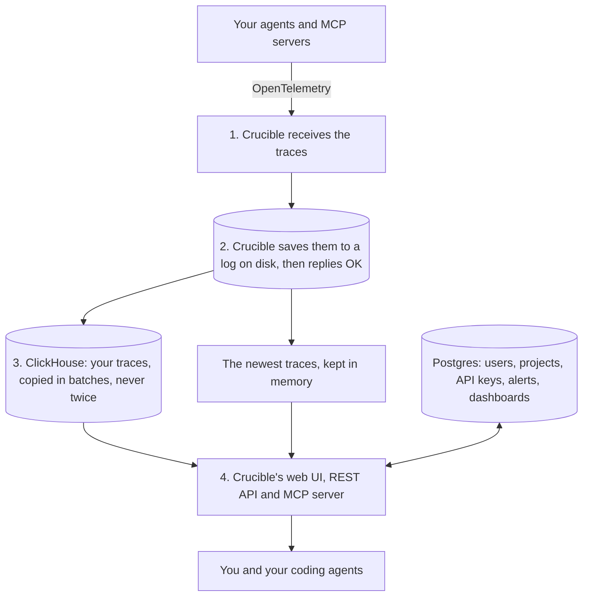

# Crucible

Open-source, self-hosted observability and analytics for AI agents and MCP servers.

Crucible is one Rust binary. It ingests OpenTelemetry traces over OTLP (HTTP and gRPC) and serves a REST API, an MCP
server, an MCP proxy and a web UI. A single-node ClickHouse (26.3 or newer) stores the telemetry and Postgres (15 or
newer) holds the control plane. Use it for agents, for MCP servers, or for both: when an agent and the MCP servers it
calls report to the same Crucible, the agent's tool call and the server's handling of it land in one trace. Crucible
is MIT licensed and runs on infrastructure you control.

## Features

**Agent observability**

- Traces, spans, sessions and users, with cost, tokens and latency. Cost is the one a span reports, or else the
  token usage priced with a bundled, versioned model price table.
- A trace page with the span tree, a timeline and an agent graph, and a payload viewer for inputs, outputs,
  system instructions, tool definitions and attributes.
- Full-text search over inputs, outputs and metadata.
- Tags, flags, feedback scores and corrections on traces, spans and sessions.
- A live tail of new traces, and a home page with the project's activity over time.
- Any OpenTelemetry SDK or Collector can send traces with no Crucible code. Spans that follow the OpenTelemetry
  GenAI conventions, or the conventions of several other instrumentation libraries, are mapped to the same fields.

**MCP servers**

- SDK wrappers for TypeScript, Python, Go and Rust record every MCP operation a server handles: method, tool,
  outcome and error class, client, session and duration. The SDKs also trace an agent's MCP client calls and carry
  their trace context to the server.
- `crucible proxy` records the same for stdio and Streamable HTTP servers without changing them. It forwards every
  byte unchanged and keeps forwarding when Crucible cannot be reached.
- Both MCP protocol eras: the session-based revisions and the stateless 2026-07-28 revision.
- MCP analytics pages for the server or the client side: servers, tools, errors, clients, users, sessions,
  operations, deploys and a compare of two deploys, with p50, p90 and p99 latency and calls the caller caused
  counted apart. Each server is read from one capture source, never a sum of two.
- MCP operations are stored in tables of their own, which the SQL workspace can query.

**Analytics**

- A metrics API over spans and traces: counts, errors, tokens, cost and latency percentiles, by minute to week,
  split by up to two dimensions.
- Dashboards of charts, numbers, tables and notes over those metrics, laid out on a grid and edited by pointer or
  keyboard, with built-in starter dashboards to duplicate and change.
- Threshold alerts on those measures and on MCP calls, delivered to webhooks, Slack and email.
- A read-only SQL workspace for each project, with saved queries. ClickHouse access control keeps each project's
  SQL inside that project's data.

**Operations**

- An organization with projects, members, roles and invitations. People sign in with a password, GitHub, Google or
  any OpenID Connect provider.
- API keys with scopes: `ingest`, `read`, `write`, `delete` and `sql`.
- Retention per project, and deletion requests for traces, users and sessions.
- Exports of a project's spans as `crucible-jsonl` or OTLP JSON, from the UI, the REST API, the `crucible export`
  command and the MCP server.
- Crucible's own MCP server at `/mcp`: a coding agent connects with a project key and lists, reads and searches
  that project's traces.
- Prometheus metrics, and `/healthz` and `/readyz` for orchestrators.

Crucible works with [rightmodeler](https://github.com/elm-os/rightmodeler): rightmodeler replays the spans of a
Crucible export to validate cheaper or newer models against the outputs you accepted.

## Quickstart

[docs/self-hosting/quickstart.md](docs/self-hosting/quickstart.md) runs Crucible with Docker Compose next to
ClickHouse and Postgres, with no clone and no build:

```sh
curl -fsSLO https://raw.githubusercontent.com/elm-os/crucible/v0.1.0/deploy/compose/compose.yaml
printf '%s\n' "CLICKHOUSE_PASSWORD=$(openssl rand -hex 16)" "POSTGRES_PASSWORD=$(openssl rand -hex 16)" "CRUCIBLE_MASTER_KEY=$(openssl rand -hex 32)" > .env
docker compose up -d --wait
```

Then create the owner from the setup link, make an API key and send a first trace. The image is
`ghcr.io/elm-os/crucible` for linux/amd64 and linux/arm64; binaries for Linux and macOS, and Windows for development,
install with a shell or PowerShell one-liner ([the binary](docs/self-hosting/README.md#the-binary)). Running against
your own ClickHouse and Postgres, every setting, upgrades, backups and monitoring are in
[docs/self-hosting](docs/self-hosting/README.md).

## Architecture

Crucible is one program. Your agents and MCP servers send it traces, it stores them in ClickHouse, and it keeps
everything else (users, projects, keys, alerts) in Postgres.



### What happens to a trace

1. **Receive.** Your agents and MCP servers send traces in OpenTelemetry, the standard tracing format: from
   Crucible's SDKs, from any OpenTelemetry exporter, or through the MCP proxy, which needs no code changes.
2. **Save, then reply.** Crucible writes each request to a log on its local disk and replies OK only after the disk
   confirms the write. If Crucible crashes, nothing it said OK to is lost.
3. **Copy once.** In the background, Crucible copies saved traces into ClickHouse in batches. Each batch carries a
   unique token, so when a copy is retried after a timeout or a crash, ClickHouse keeps one copy, never two.
4. **Read.** The web UI, the REST API and the MCP server read your traces from ClickHouse. The newest traces are also
   kept in memory, so you can see a trace the moment Crucible has replied OK to it.

### Why it's fast

Crucible is written in Rust and does as little work per trace as it can:

- It reads each incoming request once, without copying it.
- Requests that arrive together share one disk sync instead of waiting for one each.
- It writes to ClickHouse in large compressed batches, in ClickHouse's own storage format.
- It caps the memory it uses. When it is full, it asks senders to retry shortly instead of slowing down or crashing.
- Every read has a time limit and a memory limit, so one heavy query cannot slow down everything else.

### How we test it

We run the whole system in a simulator that injects disk errors, network failures, database outages and crashes,
thousands of times with different settings, and check that no trace Crucible replied OK to is lost or stored twice.
A formal model checks the protocol for saving and copying traces, machine-checked proofs cover the log's file format,
and conformance tests run against real ClickHouse and Postgres.

For the details, read the [architecture overview](docs/architecture/overview.md), the
[contracts](docs/architecture/contracts.md), the [design decisions](docs/architecture/decisions.md) and the
[testing methodology](docs/testing/methodology.md).

## Sending data

| Source | Guide |
|---|---|
| Any OpenTelemetry SDK or the Collector, over OTLP/HTTP or OTLP/gRPC | [Sending traces](docs/guides/sending-traces.md) |
| TypeScript agents, MCP servers and MCP clients (`sdk/typescript`) | [TypeScript SDK](docs/guides/sdk-typescript.md) |
| Python agents, MCP servers and MCP clients (`sdk/python`) | [Python SDK](docs/guides/sdk-python.md) |
| Go agents, MCP servers and MCP clients (`sdk/go`) | [Go SDK](docs/guides/sdk-go.md) |
| Rust agents, MCP servers and MCP clients (`sdk/rust`) | [Rust SDK](sdk/rust/README.md) |
| An MCP server you do not change, over stdio or Streamable HTTP | [MCP proxy](docs/guides/mcp-proxy.md) |
| Other instrumentation libraries and tracing SDKs, exporting OTLP | [Integrations](docs/integrations/README.md) |

Reading data back, from the REST API, is described in [docs/api](docs/api/README.md).

## Documentation

[docs/README.md](docs/README.md) indexes every page: self-hosting, guides, the API, integrations, architecture,
testing and development.

## Contributing

[CONTRIBUTING.md](CONTRIBUTING.md) covers the setup, the checks CI runs, deterministic simulation, conformance
against real databases, the SDKs and the pull request process; [docs/development.md](docs/development.md) has the
details of the dev container and of running the server from source. Commits follow Conventional Commits, and the
git hooks and CI check every commit message and file against the naming rule and refuse AI attribution trailers.
Everyone taking part follows the [code of conduct](CODE_OF_CONDUCT.md).

## Security

Report a vulnerability privately through the repository's Security tab, **Report a vulnerability**, as
[SECURITY.md](SECURITY.md) describes. Do not open a public issue for it.

## License

[MIT](LICENSE). Third-party notices are in [THIRD_PARTY_NOTICES](THIRD_PARTY_NOTICES).
