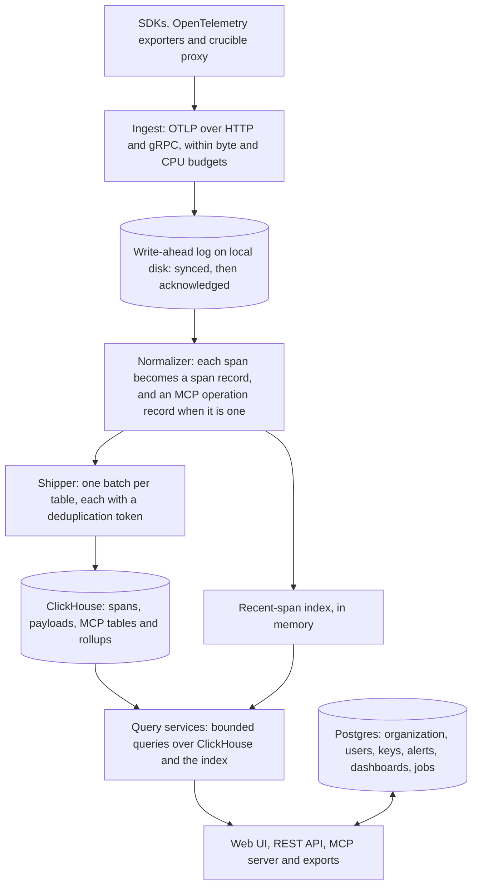

# Architecture overview

This page is the map. The binding details (records, WAL frames, the insert protocol, the API, the schemas, the
control plane) live in [`contracts.md`](contracts.md), and the reasons for the load-bearing choices in
[`decisions.md`](decisions.md).

## In brief

Crucible is one program. It receives traces, saves each request to a log on its own disk before it answers, turns
the spans into its own records, keeps the newest in memory so they can be read at once, and copies them to
ClickHouse in batches that are never stored twice. The web UI, the REST API, the MCP server and exports read through
one set of query services. Postgres holds everything that is not telemetry: the organization, users, keys, alert
rules, dashboards and the state of background jobs.

The sections below follow that path, then the pieces around it.

## Shape

Crucible is one Rust binary, `crucible`, with these roles:

| Role | Where | Notes |
|---|---|---|
| OTLP ingest | `:4318` (HTTP), `:4317` (gRPC), and `/v1/traces` on `:8080` | Protobuf or JSON, gzip; compatibility routes for other SDKs' OTLP traffic |
| REST API | `:8080/api/v1` | Code-first OpenAPI 3.1 |
| MCP server | `:8080/mcp` | Read-only tools and exports for coding agents |
| UI | `:8080/` | Next.js static export embedded in the binary |
| MCP proxy | `crucible proxy stdio -- <cmd>`, `crucible proxy http` | MCP instrumentation without code changes |
| Metrics | `127.0.0.1:9464/metrics` | Prometheus |

A deployment is the binary plus **Postgres** (the control plane) plus **ClickHouse** (telemetry): a single server,
or a cluster of one shard with several replicas, 26.3 or newer. Without Postgres the server takes its project keys from a file and runs no control-plane
features.

## Write path

From a request arriving to its spans being stored: the request is checked, saved and acknowledged, then its
spans are turned into records, made readable from memory, and copied to ClickHouse.

1. **Decode and admit.** A zero-copy scanner validates the OTLP payload (64 MiB per request including a 64 KiB
   envelope reserve, 50,000 spans per request). JSON is transcoded to protobuf. Byte budgets answer 429 or 503 with
   `Retry-After` before memory runs out, and a CPU budget (`cpu.permits`) bounds the blocking work of decoding and
   compression.
2. **WAL append.** The raw request plus an envelope (project, key, compatibility dialect) is appended to a local
   write-ahead log. A group committer issues one append and one `fsync` per group.
3. **Ack.** The client is acknowledged only after its frame is durable.
4. **Normalize.** A versioned pure function maps each span to a `SpanRecord` and, for spans with
   `mcp.method.name`, an `McpOpRecord`, through the dialect tables of `crucible-compat` for other instrumentation
   conventions. It computes cost from a versioned price table ([`price-table.md`](price-table.md)) and never
   estimates tokens. Stage B hashes MCP user subjects with each project's salt and drops the rows that a deletion
   request selects.
5. **Index.** The in-memory recent-span index makes a span readable as soon as it is acknowledged.
6. **Seal and ship.** The shipper seals a batch (`BatchSeal` in the WAL), encodes one Native block per table and
   partition, and inserts it with a deterministic deduplication token. Unknown outcomes are probed before any retry.
   While the shipper is behind the log, normalization and encoding run on blocking threads under their shares of
   the CPU budget, and the shipper's task keeps what depends on the order of the log.
7. **Checkpoint.** A low-watermark `Checkpoint` record lets fully shipped WAL segments be deleted.

Facts (tags, flags, scores, corrections) and deletion tombstones travel the same path as WAL frames of their own.
The optional `wal-uring` backend uses io_uring for WAL writes on Linux when the kernel allows it, and falls back to
the portable backend otherwise.

## Storage

What ClickHouse holds and how: rows are written once, lists read narrow tables, and a point read opens the full
payload.

- **Immutable rows.** Spans are written once. Facts are separate append-only tables, resolved latest-wins in the Rust
  tier. No query uses `FINAL`.
- **Two tiers.** `span_core` holds narrow columns and previews for lists and aggregates; `span_payload` holds full
  inputs, outputs and attributes for point reads and full-text search.
- **MCP tables.** `mcp_ops` (one row per MCP operation), `mcp_content` (opt-in arguments and results),
  `mcp_tool_inventory`, `mcp_tool_rollup` with its hourly tier `mcp_tool_rollup_hourly`, and `mcp_deploys`.
- **Derived tables written by the shipper.** `trace_heads`, `trace_stats`, session and user rollups, span metrics and
  the MCP tool rollup by minute and by hour. Latency percentiles use a deterministic integer histogram. An MCP
  analytics read over 12 hours or more takes its whole hours from the hourly tier and only the minutes at its edges
  from the minute rollup.
- **One schema description** renders the DDL, the row policies and the SQL workspace's curated views; migrations are
  forward-only steps recorded in a ledger in Postgres.

## Read path

How the UI, the API, the MCP server and exports read telemetry: every read has a time and a memory limit, and the
trace lists and trace pages also read the newest spans from memory.

Every telemetry read is a typed query plan: a scope (project), a time window, a query class with resource limits,
and a tree of nodes. The renderer turns plans into parameterized SQL, and the same plans run against an in-memory
model of ClickHouse in the simulation. Reads merge the recent-span index above the shipper's watermark, decorate rows
with resolved facts, and hide what retention and pending deletion requests remove. A request sends the store reads
that do not depend on each other together: trace by id its spans and its facts, the trace list its fact lookups. The
REST API, the MCP server and exports all read through the query services.

The SQL workspace is the one exception: it sends user SQL as written, under a per-project ClickHouse user whose row
policies, read-only profile and quota enforce isolation.

## MCP

- **Recording servers.** SDK wrappers for TypeScript, Python, Go and Rust capture every MCP operation with timing,
  outcome, error class, client and session, and opt-in arguments and results scrubbed in the SDK. The proxy forwards
  bytes unchanged and analyses a copy, so a Crucible outage never breaks an MCP session; it captures opt-in
  arguments and results with the SDKs' rules, scrubbed in the proxy.
- **Linking agents and servers.** Agents' client wrappers put W3C trace context in `params._meta`, which joins
  their tool calls and the servers' spans in one trace.
- **Serving agents.** `crucible-mcp-server` serves read-only tools, and exports, at `/mcp` over the same query
  services as the API, scoped by the project key of each request.

## Control plane and jobs

Postgres holds the organization, users, sessions, sign-in providers, projects and roles, API keys, alert rules,
their state and history, channels and the notification outbox, saved SQL queries and SQL run history, the SQL
identities, retention settings, deletion requests, export jobs, node heartbeats, job leases and cursors, and the
migrations ledger. API keys are verified from an in-memory snapshot fed by a key feed; changes reach every node
within 5 seconds.

Background work runs through `crucible-jobs` ([`adding-a-job.md`](adding-a-job.md)):

| Kind | Runs on | Jobs |
|---|---|---|
| Leader job | The one node that holds the job's lease, with fencing tokens on every write | Housekeeping; the lifecycle leader (retention and deletion steps); with an object store, the media collector and the export object sweep |
| Queue consumer | Every node, claiming rows with a lease and an attempt counter | Export jobs; alert evaluations; the notification outbox |
| Per-node timer | Every node | The alert scheduler; the lifecycle node timer (tombstones and heartbeats); the export sweep of the node's disk |

The SQL identity reconciler runs under the `sql_identities` lease, and the SQL self-probe, the key feed and the
project salts run as per-node loops.

## Crate map

The binding list of crates and their allowed dependency edges is
[contract 1.5](contracts.md#15-crate-names).

| Area | Crates |
|---|---|
| Environment | `crucible-env`, `crucible-env-prod` |
| Shared types | `crucible-records` |
| Ingest and WAL | `crucible-otlp`, `crucible-admission`, `crucible-ingest`, `crucible-wal-codec`, `crucible-wal` |
| Normalize and ship | `crucible-normalize`, `crucible-compat`, `crucible-schema`, `crucible-chfmt`, `crucible-shipper`, `crucible-store-clickhouse` |
| Read | `crucible-plan`, `crucible-recent`, `crucible-query`, `crucible-lifecycle`, `crucible-export` |
| Platform | `crucible-config`, `crucible-auth`, `crucible-control`, `crucible-control-pg`, `crucible-api`, `crucible-api-types`, `crucible-cursor`, `crucible-jobs`, `crucible-alerts`, `crucible-notify`, `crucible-egress`, `crucible-sqlws`, `crucible-media`, `crucible-ui-assets` |
| MCP | `crucible-proxy`, `crucible-mcp-server` |
| SDK | `crucible-sdk` and `crucible-sdk-conformance`, in `sdk/rust` (their own Cargo workspace) |
| Verification | `crucible-sim`, `crucible-conformance`, `crucible-loadgen`, `crucible-fake-collector` |
| Binary | `crucible` |
