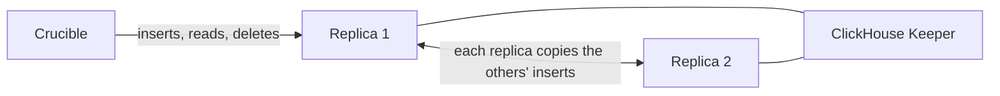

# Clustered ClickHouse

Crucible stores its telemetry on a self-hosted ClickHouse cluster of one shard with two or more replicas, coordinated
by ClickHouse Keeper. Every replica holds every table, so the telemetry survives the loss of a replica, and inserts
continue while a majority of the replicas is up. ClickHouse Cloud is refused at startup.

## How it works



1. Crucible talks to one replica, the one `clickhouse.url` names. `clickhouse.cluster` names the cluster that holds
   it in the servers' `remote_servers` configuration.
2. On its first start Crucible creates its databases, tables, users and row policies on every replica, with
   `ON CLUSTER` statements. Its tables are replicated tables (`ReplicatedMergeTree` and
   `ReplicatedAggregatingMergeTree`), so every insert and every delete reaches every replica through Keeper.
3. An insert counts as stored once a majority of the replicas holds it: both of two replicas, any two of three. The
   insert carries a deduplication token that Keeper keeps for every replica, so an insert sent again through any
   replica after a lost answer is stored once.
4. When the answer to an insert is lost, Crucible asks every replica whether the insert landed before it sends it
   again. The insert is stored once a majority holds it, and missing once every replica has answered without it; in
   between Crucible asks again.
5. Retention and deletion requests send their deletes to the replica Crucible talks to, and replication runs them on
   every replica. A deletion request is `applied` once every replica has run its deletes, and `verified` once no
   replica returns a deleted row or holds a part that still carries deleted rows.

## Run it with Docker Compose

`deploy/compose/compose.cluster.yaml` runs two ClickHouse 26.8 replicas and one ClickHouse Keeper beside Crucible and
Postgres 18. Make the `.env` file beside it once, then start it:

```sh
printf 'CLICKHOUSE_PASSWORD=%s\nCLICKHOUSE_CLUSTER_SECRET=%s\nPOSTGRES_PASSWORD=%s\nCRUCIBLE_MASTER_KEY=%s\n' \
  "$(openssl rand -hex 16)" "$(openssl rand -hex 16)" "$(openssl rand -hex 16)" "$(openssl rand -hex 32)" > .env
docker compose -f compose.cluster.yaml up -d --wait
```

Create the organization and its owner as in the [quickstart](quickstart.md#3-create-the-organization-and-its-owner),
with `docker compose -f compose.cluster.yaml exec crucible crucible admin init ...`. The optional settings of
`compose.yaml` (`CRUCIBLE_IMAGE`, `CRUCIBLE_BIND_ADDRESS`, `CRUCIBLE_HTTP_PORT`, `CRUCIBLE_OTLP_HTTP_PORT`) work the
same way here.

The file runs these services:

- `keeper`: one ClickHouse Keeper, with its log and snapshots in the volume `keeper-data`;
- `clickhouse-1` and `clickhouse-2`: the replicas, each with its own volume, in the cluster `crucible`. Both define
  the cluster with the shared secret `CLICKHOUSE_CLUSTER_SECRET`, Keeper, the macros `shard` and `replica`, and
  `distributed_ddl_use_initial_user_and_roles`;
- `postgres`: the control plane and the migrations ledger;
- `crucible`: the server, with `CRUCIBLE_CLICKHOUSE_URL=http://clickhouse-1:8123` and
  `CRUCIBLE_CLICKHOUSE_CLUSTER=crucible`, started with `--migrate`;
- `ready`: reports Crucible's `/readyz` as its health, as in `compose.yaml`.

With two replicas an insert needs both, so while one is down ClickHouse refuses inserts and Crucible keeps what it
acknowledged in its write-ahead log until the replica is back. Three replicas keep inserts going with one down; add a
`clickhouse-3` service and a third `<replica>` to the cluster definition in the file.

## Point Crucible at a cluster you run

Set two settings ([configuration](configuration.md#clickhouse)):

| Setting | Value |
|---|---|
| `clickhouse.url` (`CRUCIBLE_CLICKHOUSE_URL`, `--clickhouse-url`) | The HTTP endpoint of one replica, for example `http://clickhouse-1.internal:8123` |
| `clickhouse.cluster` (`CRUCIBLE_CLICKHOUSE_CLUSTER`, `--clickhouse-cluster`) | The cluster's name in `remote_servers` |

The cluster needs the following. Before any statement runs on the cluster, Crucible checks each item on the replica it
talks to and refuses to start with a message that names what to change.

- **One shard.** The named cluster has one shard with two or more replicas. A cluster of several shards is refused.
- **A cluster secret.** The cluster's entry in `remote_servers` holds a `<secret>` on every replica, so a query that
  one replica sends to another runs as the user who sent it. Without it, that query runs as the user that
  `remote_servers` names, whose grants and row policies are not Crucible's.
- **Keeper.** Every replica has a `<zookeeper>` section that reaches ClickHouse Keeper.
- **The macros `shard` and `replica`** on every replica. Crucible's replication path is
  `/clickhouse/tables/{shard}/{database}/{table}` and its replica name `{replica}`.
- **`distributed_ddl_use_initial_user_and_roles` set to 1** on every replica. The `ON CLUSTER` statements that
  create the text indexes need it.
- **The admin user on every replica**, with the same password and with access management, as on a single server
  ([your own ClickHouse](README.md#your-own-clickhouse-and-postgres)). Crucible creates its service users and the
  SQL workspace's users on every replica with it.
- **No single-server tables.** The database `crucible` is empty or absent: Crucible creates its tables. Tables that
  are not replicated, such as those of a single-server deployment, are refused, and Crucible does not convert them.
- **ClickHouse 26.3 or newer**, with the settings Crucible sends, as on a single server.

A `remote_servers` entry with all of this, on every replica:

```xml
<clickhouse>
  <remote_servers>
    <crucible>
      <secret from_env="CLICKHOUSE_CLUSTER_SECRET"/>
      <shard>
        <internal_replication>true</internal_replication>
        <replica><host>clickhouse-1.internal</host><port>9000</port></replica>
        <replica><host>clickhouse-2.internal</host><port>9000</port></replica>
        <replica><host>clickhouse-3.internal</host><port>9000</port></replica>
      </shard>
    </crucible>
  </remote_servers>
  <zookeeper>
    <node><host>keeper-1.internal</host><port>9181</port></node>
    <node><host>keeper-2.internal</host><port>9181</port></node>
    <node><host>keeper-3.internal</host><port>9181</port></node>
  </zookeeper>
  <macros>
    <shard>01</shard>
    <replica>clickhouse-1.internal</replica>
  </macros>
  <distributed_ddl_use_initial_user_and_roles>1</distributed_ddl_use_initial_user_and_roles>
</clickhouse>
```

Each replica names itself in `<replica>` under `<macros>`.

### One address, not a list

Crucible reaches the cluster through the one address in `clickhouse.url`. The insert protocol holds whichever replica
answers there: an insert sent again is checked against the tokens that Keeper keeps for every replica, and the
question whether a lost insert landed goes to every replica. A list of replicas in Crucible would add nothing to that.

The address can be one replica, or a balancer that sends every connection to one replica while it is up and moves to
another only when that one is down (active and backup). Do not spread Crucible's connections over the replicas: a
delete is followed by a read of the work it started, and a replica that lags behind may not list that work yet.

## What Keeper needs

- Keeper holds each table's replication log, the parts each replica holds, and the deduplication tokens of the last
  20,000 inserts into each table, for at most 2 hours.
- While no replica reaches Keeper, the replicated tables are read-only: reads work, inserts are refused, and Crucible
  keeps what it acknowledged in its write-ahead log and sends it again once Keeper answers.
- Three Keeper servers keep the cluster writable while one of them is down; the Compose file runs one.
- Keep Keeper's volume with the replicas' volumes: the replicas cannot accept inserts without the state it holds.

## Failure behaviour

| What fails | What happens |
|---|---|
| One of three replicas | Inserts land on the other two. Reads and the API work while the replica Crucible talks to is up. A deletion request reaches `applied` once the replica is back and has run its deletes; a retention partition drop is sent again until every replica has run it |
| One of two replicas | An insert needs both replicas, so ClickHouse refuses it (`TOO_FEW_LIVE_REPLICAS`). Ingest continues into the write-ahead log, which is shipped once the replica is back. A server that starts meanwhile stays not ready, with the reason |
| A replica, in the middle of an insert | The insert's outcome is unknown. Crucible sends it again only after every replica has answered without it, and counts it stored once a majority holds it |
| The replica that `clickhouse.url` names | Crucible cannot reach ClickHouse, as with a single server that is down: ingest continues into the write-ahead log, the trace list and trace detail answer from memory and say the answer is partial, and other reads answer `telemetry_store_unavailable`. A balancer that fails over to another replica keeps Crucible connected |
| Keeper | The replicated tables are read-only: reads work, and inserts wait in the write-ahead log |
| A replica, while a migration step applies | The step fails and the ledger does not record it. `crucible migrate` exits with 1, and a server started with `--migrate` stays not ready; both name the replica, for example `clickhouse-2:9000 in cluster crucible did not answer, and every replica runs the ON CLUSTER statements: start it, then migrate again` |

The write-ahead log grows while inserts wait. When it reaches its high-water mark, or the disk is nearly full, ingest
answers 503 with `Retry-After` ([operations](operations.md#memory-and-disk)).

## Reads while a replica lags

Crucible reads from the replica it talks to. An insert lands on that replica first and counts as stored once a
majority holds it, so reads through one replica, or through a balancer that keeps to one replica, return every
acknowledged row.

After a balancer moves to another replica, a read can miss rows stored in the last moments until that replica has
fetched them. This happens only when the new replica was outside an insert's majority, which needs three replicas or
more: with two, every stored insert is on both. On the server that received a trace, the trace stays readable from
memory for 10 seconds after ClickHouse holds it, which covers the usual replication delay.

No ClickHouse setting closes this gap. `select_sequential_consistency` works only while quorum inserts run one at a
time (`insert_quorum_parallel = 0`), and Crucible runs several inserts into one table at once.

## Upgrades

- Upgrade ClickHouse one replica at a time. Wait until each replica is healthy and has caught up
  (`SELECT max(absolute_delay) FROM system.replicas` answers 0) before the next. With two replicas, inserts wait in
  the write-ahead log while one restarts.
- A Crucible version that adds a migration step applies it `ON CLUSTER`, so every replica must be up. A start with a
  replica down stays not ready, names the replica, and applies the step once the replica answers.
- Without Postgres there is no migrations ledger, so `--migrate` applies every step at each start, and each start
  needs every replica.
- The rest of [operations](operations.md#upgrades) applies as on a single server: keep the master key, and take a
  backup before an upgrade.
